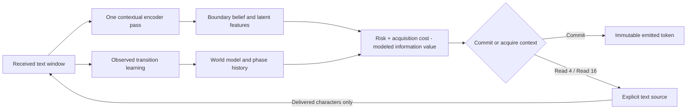

# Grounded AIT: observe, plan, acquire, update

AIT now has an optional closed loop whose actions acquire actual text context.
It can commit a token, request four more characters, or request sixteen. Its
boundary beliefs, latent world model, and phase diagnostics update from delivered
characters. Hypothetical planning cannot train the model or advance phase history.

This extends the [policy/learning repair](policy-learning-2026-10-08.md). The
earlier `posterior_risk` selector re-decodes the same evidence and correctly has
zero information gain. The new acquisition controller actually changes which
context has arrived before an irreversible output.

## Completed results

The frozen run completed all seven modes: **1,953 test episodes** over the same
279 sentences (93 per language), plus the disjoint calibration and cost-selection
stages. Development selected character cost **0.0005** from the predefined grid.

| Language | Immediate marginal MAP F1 | Learned acquisition, no drives F1 | Full active F1 | Fixed lookahead/confidence F1 |
| --- | ---: | ---: | ---: | ---: |
| English | 99.8115% | 99.8151% | 99.8151% | 98.6221% |
| Japanese | 93.8825% | 95.5277% | 95.5277% | 94.8241% |
| Chinese | 86.8905% | 89.2998% | 89.2998% | 89.4322% |

Relative to immediate marginal commits, learned acquisition improves the point
estimate in Japanese and Chinese. Relative to the fixed streaming reference,
the full active result improves in English/Japanese and slightly regresses in
Chinese. The fixed reference also uses a confidence threshold and a different
commit schedule; this is a comparison of complete bounded controllers.
The learned modes include an additional supervised observation model, so the
differences cannot be attributed to scheduling or unsupervised world learning alone.

| Language | Mean wait: immediate → active (received characters) | p95 wait: active | Mean wait: fixed |
| --- | ---: | ---: | ---: |
| English | 2.48 → 3.43 | 6 | 17.83 |
| Japanese | 2.45 → 24.10 | 59 | 22.06 |
| Chinese | 2.45 → 18.03 | 44 | 17.65 |

Waiting is measured in newly received characters after a token end, not human
input time. Full-text references are also reported in the JSON; they see all
context before producing output and are not guaranteed F1 upper bounds.

### The feedback loop executes; its extra quality value is still unconfirmed

- Full active requested context for modeled value **700 times**. It made 488
  sixteen-character requests. Of its supported focused forecasts, **525**
  received the full requested extension; truncated EOF acquisitions are excluded
  from matched information averages.
- **78 of those 525 realized entropy changes were negative**: actual evidence
  made the focused boundary less certain. That is retained in the trace, rather
  than clamped into a positive reward.
- The warmed world learned from 150 actual calibration transitions. During
  test replay, it refitted **120 times across 80 English episodes**. Japanese
  and Chinese episodes made too few acquisitions to reach the 16-observation
  online training cadence; their online refit count was zero.
- Full active and frozen-world produced **identical final predictions in all
  279 cases**, despite those English refits. Removing the phase/error drives
  changed policy-count summaries in two episodes, but again changed no final
  predictions. This run does not establish an accuracy gain from either the
  online world updates or phase/error modulation.
- No active episode needed a forced cut; the fixed streaming reference made
  three capacity-forced cuts in English and one in Japanese.

### Runtime cost

| Language | Fixed median episode ms | Active, frozen world median ms | Full active median ms |
| --- | ---: | ---: | ---: |
| English | 44.88 | 110.89 | 182.35 |
| Japanese | 12.33 | 36.57 | 35.26 |
| Chinese | 6.86 | 10.65 | 10.74 |

The active controller is more expensive than fixed streaming here. English
online fitting adds substantial CPU time without a demonstrated quality gain.
Fewer encoder calls than immediate commits do not imply lower total runtime:
planning, per-token reinspections, replay copying, and world fitting also cost
time. These sequential local timings are descriptive, not a platform speed claim.

### Channel check on the separate cost-selection half

Every checked raw state/action had minimum label support in the pooled channel;
that 100% support coverage is not a calibration guarantee. One-step held-out
Brier error before and after conditioning on the actual new outcome was:

| Language / acquired characters | Before Brier | After channel update Brier |
| --- | ---: | ---: |
| en/acquire_4 | 0.002219 | 0.002242 |
| en/acquire_16 | 0.002213 | 0.002258 |
| ja/acquire_4 | 0.053589 | 0.053751 |
| ja/acquire_16 | 0.055216 | 0.058694 |
| zh/acquire_4 | 0.108326 | 0.107402 |
| zh/acquire_16 | 0.116910 | 0.115145 |

English/Japanese Brier error worsens slightly in these checks, while Chinese
improves. The finite channel is a usable explicit observation hypothesis, not
an established correctness calibrator. Its overlapping calibration pairs and
coarse Markov bins require further independent validation. All new behavior
remains opt-in; the normal segmentation API does not turn on acquisition.

Evidence: [prepared plan](../reports/active-context-2026-10-27/plan.json),
[all metrics and receipts](../reports/active-context-2026-10-27/summary.json), and
[matched per-sentence scores](../reports/active-context-2026-10-27/paired_scores.jsonl).

### Runnable observation traces

After completing the study locally, run:

```bash
python scripts/demo_active_ait.py --study .cache/active-context-pilot-v1
```

The default is the 211-character authored example; `--text` supplies another input.
The [short authored replay](../reports/active-context-2026-10-27/demo_trace.json)
contains a real entropy increase at event 23. It performs no online refit
because its 11 acquisitions do not reach the training cadence. The
[211-character authored replay](../reports/active-context-2026-10-27/demo_trace_long.json)
makes 43 acquisitions and performs two online refits at events 34 and 78;
events 46 and 92 increase entropy. These are provided-text replays, not live
network/human interactions or labeled quality evaluations. Both preserve the
source exactly and keep the segmenter and channel hashes unchanged.

## Mechanism



### Prediction and execution are separate

The old latent loop recorded generated teacher targets while evaluating branches,
advanced phase state for hypothetical steps, and discarded the observation-
conditioned posterior during execution. These paths are repaired:

- `OnePassAIT.predict_next` / `forecast_transition` are pure. An untrained world
  model uses an explicitly labeled persistence forecast; that forecast is never
  recorded as an observation.
- `observe_transition` requires delivered feature vectors, an explicit source,
  and a strictly increasing observation ID. Real observations enter bounded
  replay once; simulations are labeled and excluded from real replay/phase
  learning. `train=False` records real observations but freezes world weights.
- The generic `ActiveInferenceAgent` requires `ExecutionObservation` or an
  explicit execution callback. It conditions the predicted next prior and keeps
  that posterior. A pending delivery survives failed assimilation/learning and
  checkpoint/resume, so retry does not consume another external observation.
- Rollout branches only forecast. The Gaussian planner integrates latent
  predictive covariance **P** plus sensor likelihood noise **R** in preference
  risk, and conditions its hypothetical posterior with **R**. CEM returns the
  best evaluated sequence rather than an untested coordinate-wise mode.

The separate latent dynamics model now minimizes mean diagonal-Gaussian NLL,
with a positive softplus process variance, correct derivatives, and one batch
average. Its observation counters, bounded replay, and readiness provenance are
saved. Legacy synthetic-trained dynamics remain explicitly unverified; old
unverified global phase histories are cleared on load. Direct segmenter weights
and their predictions are preserved.

### A learned observation channel grounds information value

Let **Y** be a gold boundary label, **s** the currently observed raw-CRF
probability/age bin, **a** an acquisition size, and **Z** the raw-CRF probability
bin after actually appending that amount of context. Calibration learns the
finite channel `P(Z | Y, s, a)` from real same-left-window prefix pairs and their
original labels. It does not assign arbitrary observation precision by policy.

Given the current label prior `p(Y)`, the channel computes outcome probabilities,
Bayesian label posteriors, expected binary boundary risk, and mutual information
`I(Y; Z | s, a)`. Unsupported cells return zero modeled gain. Symmetric smoothing
is enabled only after both label classes have real support.

After a complete acquisition, the controller selects the **actually observed Z**
and conditions its previous label prior using that likelihood. It never
multiplies two overlapping raw-CRF posteriors as independent evidence. New or
unsupported boundaries, truncated end-of-source extensions, and reframed
windows fall back to the current raw CRF belief.

The bounded tree carries the label prior separately from the observed raw-state
bin. Future outcome bins become future conditioning states. This is a **coarse
controlled Markov-channel assumption**, not proof that probability bins capture
all textual history. Multistep planning requires matching state/outcome bins.
Real observations can increase entropy; signed realized changes are logged
separately from expected information gain.

### Phase and prediction error affect actual acquisition

The controller focuses on the most uncertain uncommitted boundary in the next
token. It uses marginal-MAP cuts, so its immediate binary risk matches the
decision rule. The objective combines future boundary risk, requested-character
cost, inspection cost, and modeled information value. This focused-boundary
objective is a proxy for whole-token F1, not an accuracy guarantee.

The information weight is modulated by observed phase mixing and the last
world-model prediction error. The phase term uses the existing three-plane
tracker; the error is measured in pooled encoder-feature space. These bounded
control heuristics are not semantic surprise or a physical law. Forecasts use
the **pre-acquisition** context. Neither phase nor replay updates during a plan
or a pure reinspection after a commit.

The latent observation is the mean of bounded contextual encoder states across
the window, obtained in the same forward pass as the boundary logits. Averaging
neighbor differences would telescope into an endpoint-only feature; that is
deliberately avoided here. Runtime world learning never updates the segmenter
head, encoder weights, local phase basis, or frozen acquisition channel.

## Runtime and recovery

```python
from spiralreality_AIT_onepass_aifcore_integrated.integrated.active_context import (
    ActiveContextConfig, StringTextSource,
)

# model: a Python-context OnePassAIT; channel: fitted on labeled prefix pairs
session = model.active_text_session(channel, ActiveContextConfig())
source = StringTextSource("When evidence changes, revise. 文脈を確かめてから決める。")
result = session.run(source)
print(result["tokens"], result["metrics"])
```

`plan()` has no source access. `execute()` accepts the corresponding delivered
receipt or executes that request through `source.read(count, observation_id)`.
Stale plans and duplicate/replacement deliveries reject. `StringTextSource`
replays its last request idempotently. If inspection/learning fails after a valid
read, the session retains that receipt for retry rather than losing consumed text.

The default inference window is 96 characters with at most 32 characters of
left context, a two-step channel horizon, and at most four acquisitions per
commit. Reads preserve the left-window start used by the channel. Capacity and
acquisition-budget cuts are counted separately. A 256-event trace retains recent
diagnostics; cumulative metrics remain available after trace truncation.

`run(max_steps=...)` returns partial emitted tokens with `done=False` when its
step budget ends. On runtime failure, `ActiveSessionError.partial_result` keeps
already emitted output; `step()` supports direct streaming consumption. Model
checkpoints preserve learned world/phase state and generic-agent pending
deliveries. They do not serialize an `ActiveTextSession` buffer or a caller's
source cursor; cross-process stream recovery still needs caller-owned stream
state. Observation source labels are caller-declared provenance, not independent
verification of an external sensor.

## Frozen exploratory protocol

- Reuse the pinned PUD r2.18 sources and the exact trained checkpoint
  `9c73420a3c7fe4e9d73cc463b473b0b45c01a7111f058bbf100943136a81e783`.
  Its segmenter was trained on 804 sentences per language. The checkpoint's
  learning rate was previously selected using all original development labels.
- Split that original development fold by document group: 20 groups / 50
  sentences per language for channel calibration/world warmup, and a disjoint
  20 groups / 50 per language for current cost selection and channel checking.
- Fit actual same-start prefix extensions of 4/16 characters in bounded windows.
  The channel requires at least five examples of each label per state/action
  cell, with symmetric alpha 0.5. Overlapping pairs are correlated observations.
- Warm the world model from one sampled actual extension per calibration sentence
  (150 transitions), then reset phase histories. Protected segmenter/encoder/
  local-phase hashes must match before and after warmup.
- Freeze the channel. Select one character cost from 0.0005, 0.002, 0.01 using
  equal-language development F1 minus predefined wait and encoder-call penalties.
  Save all choices before test evaluation.
- Evaluate seven modes on the same 40 document groups / 93 sentences per
  language: fixed 16-character lookahead with confidence 0.8; immediate commits;
  learned acquisition without phase/error drives; full active; frozen-world
  active; full-text Viterbi; and full-text marginal-MAP.
- Streaming modes share the marginal-MAP decision rule. The learned modes also
  change the belief model through the fitted channel. Their comparison to raw
  marginals therefore includes observation-model updating and acquisition,
  rather than isolating scheduling alone. Frozen-world versus acquisition-only
  isolates phase/error drives; active versus frozen-world isolates online fitting.
- Restore the same warmed world and segmenter before every sentence. Test
  observations can adapt that episode's world model without labels; no world
  state or label-channel updates carry between test sentences.

The contract is `ff8bd11f9d24ded054d67852ab31ed2bd025eafe489ff286015d65b6fcc556ab`.
It binds code, checkpoint, data, partition, runtime, actions, and cost selection.
The [config](../configs/active-context-pilot.json) records exact settings. Raw
corpus text, learned channel, warm-world weights, and detailed episode traces stay
local. Public evidence contains hashes, aggregates, and compact paired scores.
Dataset attribution and the upstream source-text ownership caveat remain in
[the original source documentation](trilingual-context-2026-10-08.md#attribution-and-source-terms).

This is previously inspected translated news/Wikipedia text, one checkpoint and
one partition, with prior development/test exposure. It is mechanism and
cost-quality evidence, not independent-corpus or live-interaction confirmation.
Expected information is under a fitted channel; it is not realized accuracy or
independently measured semantic information. Report actual signed entropy
changes, support coverage, boundary quality, waiting, and cost together.

Episode timings include planning and online world fitting, excluding common
checkpoint restoration/scoring/serialization. They are local descriptive CPU
measurements. Encoder calls and the sum of squared window lengths are useful
work proxies; they cannot establish a reduction in total CPU work or latency.

## Validation

- 420 tests passed, one skipped, and nine subtests passed. Tests cover pure
  planning, actual posterior math, Gaussian NLL gradients, batch invariance,
  covariance-aware risk, observation IDs, simulated-evidence exclusion, pending
  delivery retries/checkpoints, and the finite channel's Bayes/MI identities.
- Session checks cover hidden-suffix independence, forecast-before-read order,
  conditional belief updates, input preservation, window/trace bounds, truncated
  forecasts, stale plans, retained reads, and partial-output recovery. The offline
  runner checks document isolation, cost selection, artifact corruption, decoder
  matching, protected-head warmup, resume, and timing boundaries.
- Built source distribution/wheel. A fresh installed-wheel environment outside
  the checkout verified three-language acquisition, pure plans, actual online
  world updates, unchanged segmentation weights, and world/replay/phase checkpoint
  continuation. The default authored demo reproduced its saved 129 events and
  two online refits exactly after JSON serialization.
- Checked the frozen source/checkpoint/channel/world hashes, all 1,953 test
  episodes, 279 paired rows, development-before-test selection, and publication
  hygiene. Corpus text and learned weights remain local; the only public token
  traces use the explicitly authored demo inputs.
